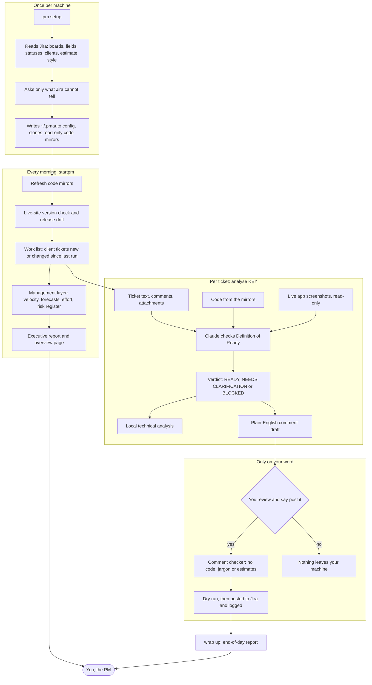
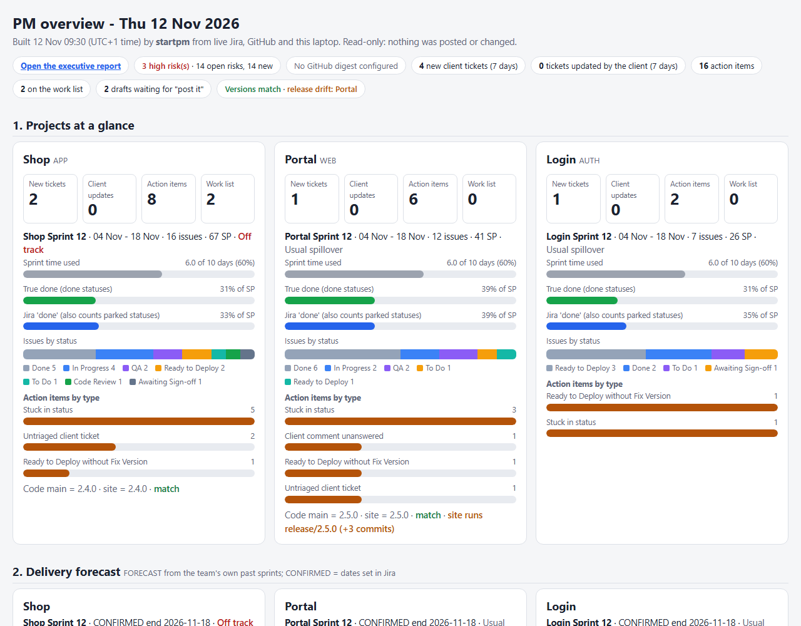
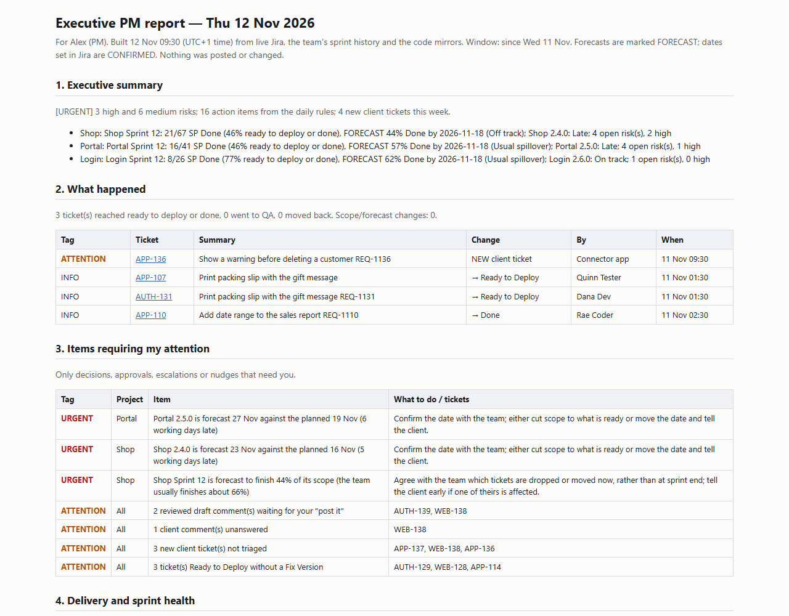

# Agentic PM Autopilot

Agentic PM Autopilot turns **Claude Code into the orchestrating project manager for any Jira project**, on your own machine.

- **Every morning** (`startpm`) it reads Jira and finds new and changed client tickets. It refreshes read-only copies of your code and checks that the version on your live site matches the code. It then opens one page with every project at a glance, forecasts, risks, effort, new tickets and client updates.
- **For each client ticket** it reads the ticket, the code and the live app, and grades the ticket against a Definition of Ready. It writes a technical analysis for you and a **plain-English Jira comment** (a specification, or precise questions for the client).
- **You approve every comment.** Nothing is posted without your "post it". It never assigns tickets or changes status, sprint or fields.
- **The management layer** keeps daily history and velocity, forecasts sprint completion and release dates, tracks effort against estimates, keeps a risk register, and writes an **executive report** (eight sections, each item tagged URGENT, ATTENTION or INFO).

Scripts do the repetitive work with no AI: reading Jira, change detection, version checks, the work list, history, forecasts, the audit log and reports. Claude Code does the thinking: analysis, questions, plain-English writing, matching meeting clarifications to tickets, and reviewing its own subagents' work.

## How it works



Everything runs on your machine. Jira is read, never changed, except for the comments you approve; the tool never assigns tickets or changes status, sprint or fields.

## What you get every morning

A sample built by the real code from **made-up data** (an invented team, "Acme", with three projects). Your own pages look the same, filled with your Jira.

**PM overview** (`startpm` opens it): projects at a glance, delivery forecast, releases, risk register, effort and overruns, new and updated client tickets, action items.



**Executive report**: eight sections, each item tagged URGENT, ATTENTION or INFO.



Open the full samples: [PM overview](https://htmlpreview.github.io/?https://github.com/shasan7774bs23/agentic-pm-autopilot/blob/main/docs/sample/sample-overview.html) · [Executive report](https://htmlpreview.github.io/?https://github.com/shasan7774bs23/agentic-pm-autopilot/blob/main/docs/sample/sample-executive-report.html) · [full-page screenshot](docs/sample/overview-full.png). The HTML files are also in [`docs/sample/`](docs/sample/) to download and open in a browser; `docs/sample/make_sample.py` rebuilds them.

## Install (once per machine)

1. Install **Python 3.11+**, **Git**, **Node.js 20+** and **Claude Code** (`npm install -g @anthropic-ai/claude-code`).
2. `git clone https://github.com/shasan7774bs23/agentic-pm-autopilot.git` and open Claude Code in that folder.
3. Say **`pm setup`**. Claude Code will:
   - check the machine and create `~/.pmauto/`;
   - ask you to type your Jira site, email and API token into `~/.pmauto/credentials.env` (secrets never go through the chat);
   - read Jira to pre-fill your boards, fields, workflow statuses, likely client accounts and estimate style;
   - ask you, once and for all your projects, only what Jira cannot tell it: your code repos, live sites, test accounts, meeting, short names and the words your comments may use;
   - write your config, clone read-only mirrors of your code, install the browser for site checks, and run a first `startpm` to prove it works.

Already have a team config from a teammate? Give its path when setup asks, and you'll only answer the personal questions.

| Needed | What for | Required? |
|---|---|---|
| Jira Cloud account + API token | Everything | Yes |
| Read access to your code repos (git) | Ticket analysis against the code | Recommended |
| Test-account roster JSON (kept outside any repo) | Live-site screenshots and version check | Optional |
| Microsoft 365 connector in Claude Code | Reading client-meeting transcripts | Optional |
| A **private** GitHub repo | Scheduled daily digest email (`examples/private-layer/`) | Optional |

## Daily use (say it to Claude Code in this folder)

| You say | What happens |
|---|---|
| `startpm` | Morning run: digest, mirrors, version check, work list, forecasts, risks, executive report, overview page |
| `analyse ABC-123` | Analysis + plain-English comment draft for one ticket |
| `post it` (for a ticket) | Dry run first, then posts only after you confirm |
| `wrap up` | End-of-day ticket report; closes test browsers |
| `pm setup` | Change your answers or add a project |

## Commands

```bash
python -m pmauto setup                 # check this machine (creates ~/.pmauto on first run)
python -m pmauto info                  # what is configured here (no secrets)
python -m pmauto discover --projects A,B   # read Jira to pre-fill setup (read-only)
python -m pmauto init --answers a.json # write config from the setup answers
python -m pmauto startpm               # the morning run (opens the overview page)
python -m pmauto pm                    # forecasts, effort, risk register, executive report
python -m pmauto queue                 # re-check client tickets later in the day
python -m pmauto context KEY           # context pack for one ticket
python -m pmauto look PROJ account out /Path   # read-only screenshots of the live app
python -m pmauto mark KEY --file F --verdict READY
python -m pmauto post KEY KEY-comment.md [--attach KEY-shot.png] [--yes]
python -m pmauto report                # end-of-day ticket report
python -m pmauto accounts              # test accounts by role (never prints passwords)
python -m pmauto show FILE             # open a report in your browser
python -m pmauto close-windows         # close the test browsers it started
python -m pmauto daily                 # the digest (normally run by the scheduled workflow)
```

## Where things live

| What | Where |
|---|---|
| Your settings (points at the team config) | `~/.pmauto/config.json` |
| Jira credentials | `~/.pmauto/credentials.env` (never committed, never printed) |
| Team config: projects, statuses, clients, repos, sites | on your machine by default (`~/.pmauto/teams/`); never in this repo |
| Project notes the analyst reads every session | `project_notes` in the config (Markdown) |
| Memory: analysed tickets, work list, history, risks, audit log | `<analyses_dir>/pm.sqlite` |
| Analyses, comment drafts, screenshots, meeting transcripts | `<analyses_dir>/` |
| Overview page, executive report, end-of-day report | `<reports_dir>/<date>/` |
| Read-only code mirrors | `<mirror_root>/*.git` |
| How tickets are worked / how setup runs | `.claude/skills/ticket-analyst/`, `.claude/skills/pm-setup/` |

`config/example.json` shows every setting with made-up values. Nothing about a team's workflow is built in; setup asks for it:

| Setting | What it describes |
|---|---|
| `status_groups` | Your Jira status names, sorted into `not_started`, `in_progress`, `review`, `qa`, `parked`, `ready_to_deploy`, `true_done` |
| `estimate_comment_labels` | How estimates are written in a comment, e.g. `{"DEV": "dev", "QA": "qa"}` for `DEV - 1 / QA - 0.5` |
| `client_reference` | The client's own number in ticket titles (label + regex), if any |
| `clarification_sprint`, `delivery_sprint_pattern` | Where tickets wait for client answers; which sprints count for velocity |
| `code_repos.<KEY>.release_branch_pattern` | Read the newest release branch instead of a fixed one (regex with version groups) |
| `login` | Sign-in page selectors for the live-site check, and a page to stop at (`stop_if_url`) |

`python -m pmauto info` lists the current values and warns about anything missing or invalid.

## The management layer

- **History:** a daily snapshot of every sprint, project and release. Velocity comes from Jira's own sprint report for the last 12 closed sprints, so forecasts work from day one.
- **Forecasts:**
  - Sprints: expected Done at the end date, judged against the team's own usual completion rate. "Usual spillover" is not an alarm; doing worse than usual is.
  - Releases: a forecast date from the running sprint's flow to Ready to Deploy, shown beside the date set in Jira.
  - Every forecast says what changed since the last run. FORECAST and CONFIRMED are always labelled.
- **Effort:**
  - Planned effort comes from the team's estimate comment (labels set at setup, e.g. `DEV - 1 / QA - 0.5`), else Jira's Original Estimate, else story points × hours per point. Actual effort is time logged on the ticket.
  - It flags overruns, tickets likely to run over, time logged with no progress, repeat patterns, and remaining work per person against the working days left (stage-aware: in QA only the QA part counts).
  - An overrun is a question to ask, not a verdict.
- **Risk register:** risks are remembered across days, marked NEW, and closed automatically when the condition goes away. Each has its impact, evidence, recommended action and owner.

## Safety rules (enforced in code where possible)

| Rule | How it is enforced |
|---|---|
| Developers' own clones are never touched | Only bare mirrors (`*.git`) can be fetched; anything else is refused |
| The live app is never changed | The viewer has no click or submit step; it can only sign in, open pages and take screenshots |
| Comments are plain business English | `post` accepts only `KEY-comment.md` and refuses code, file names, jargon and estimates |
| Nothing is posted without the PM | Every post is a dry run unless the PM confirms (`--yes`); a second post needs `--again` |
| No assigning, status, sprint or field changes | No command does any of these |
| Secrets stay on the machine | Credentials live only in `~/.pmauto/credentials.env`; no command prints them |
| Client data never goes public | Team configs, reports and digests live in private places; this repo holds only the generic tool |
| Every action is recorded | The `audit` table in `pm.sqlite`, failures included |

## Scheduled daily digest (optional)

The digest is a GitHub issue that GitHub emails to you every working morning. It contains ticket text, so it **must run from a private repo**, never this public one. `examples/private-layer/` has the workflow and a short guide: the private repo holds your team config and secrets, and checks out this tool at run time.

## Tests

`python -m unittest discover -s tests -t .` (no network, uses a made-up config in `tests/fixture_config.json`).

## Licence

MIT: see [LICENSE](LICENSE).
